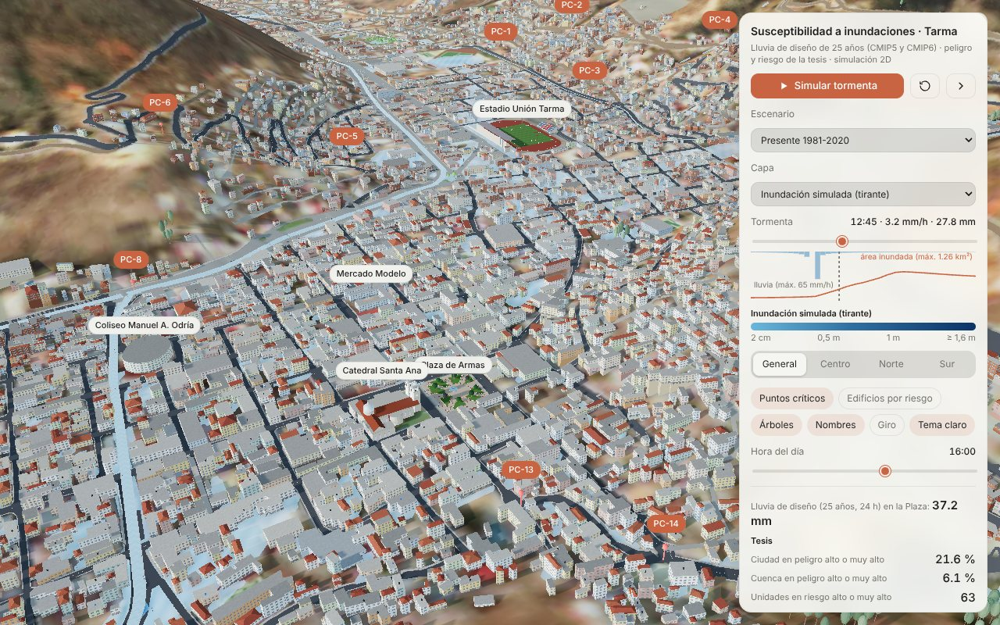
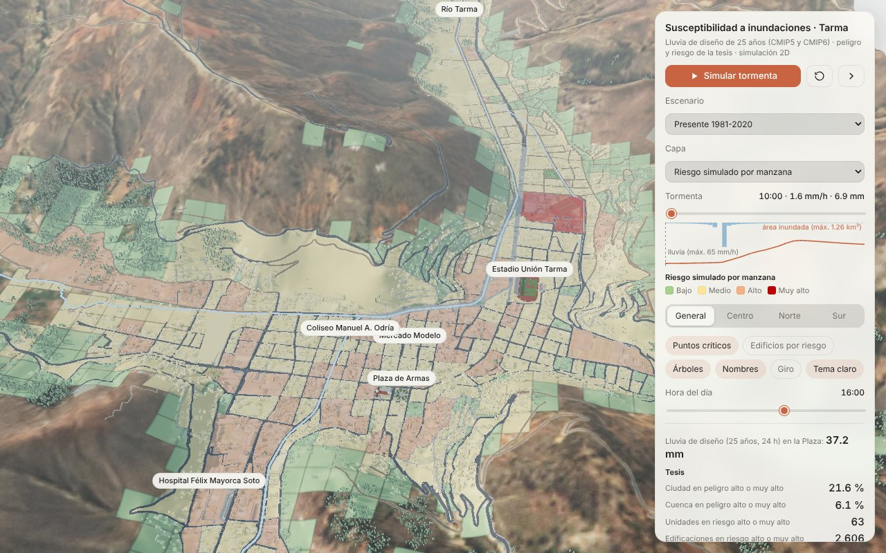
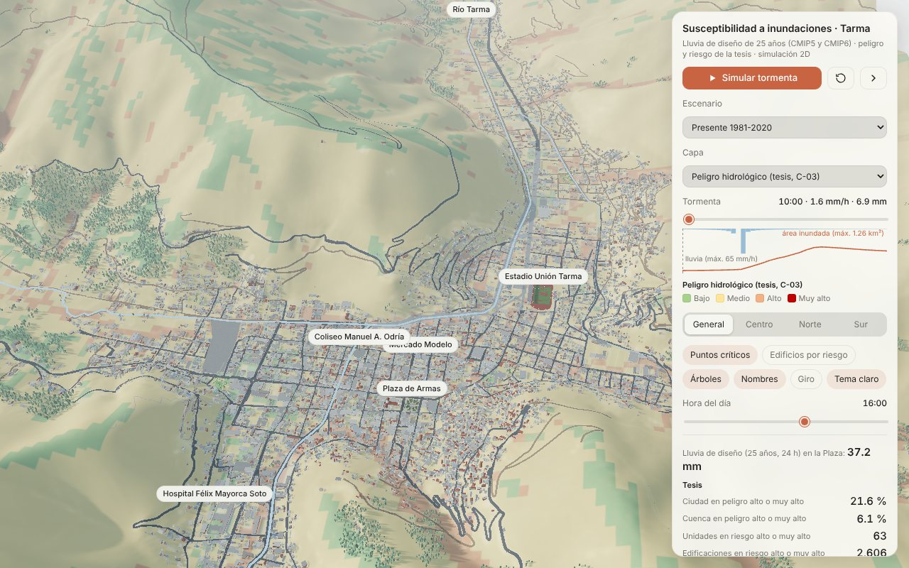
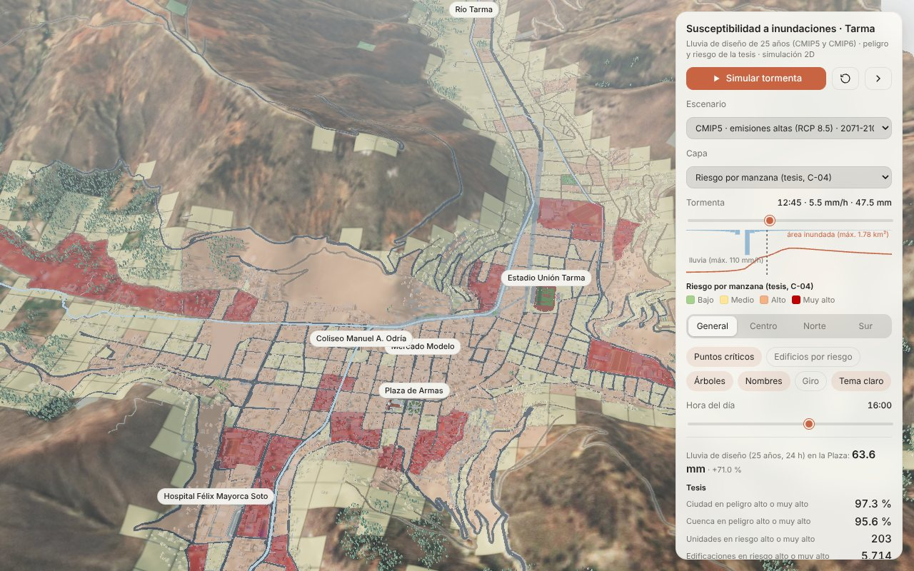
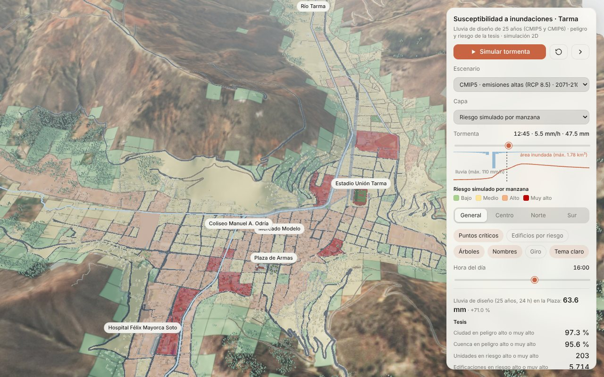
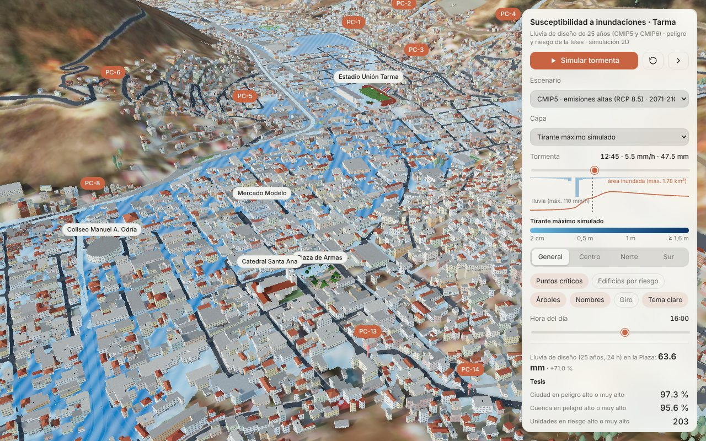
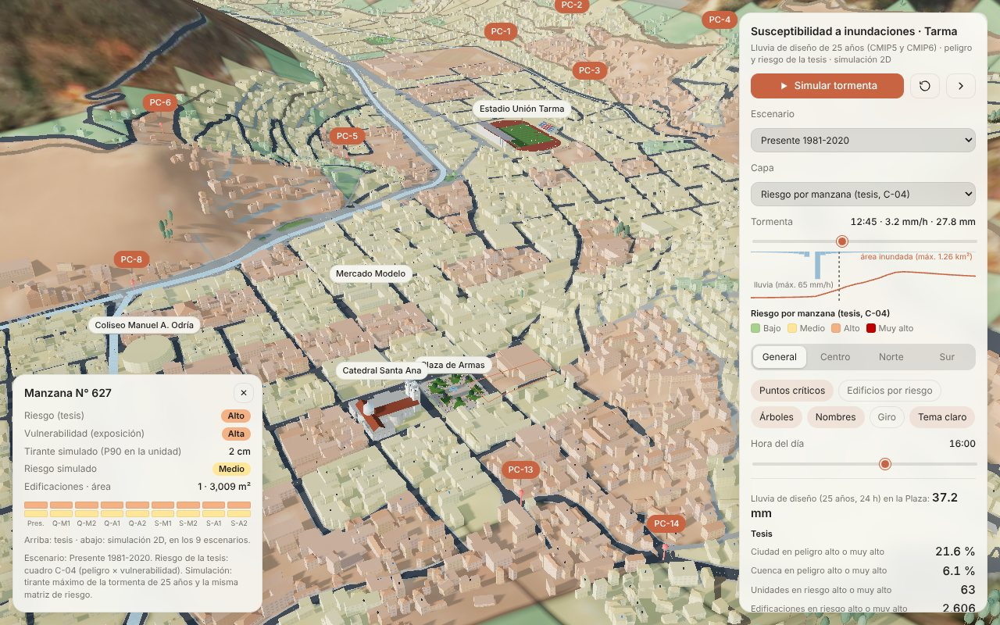
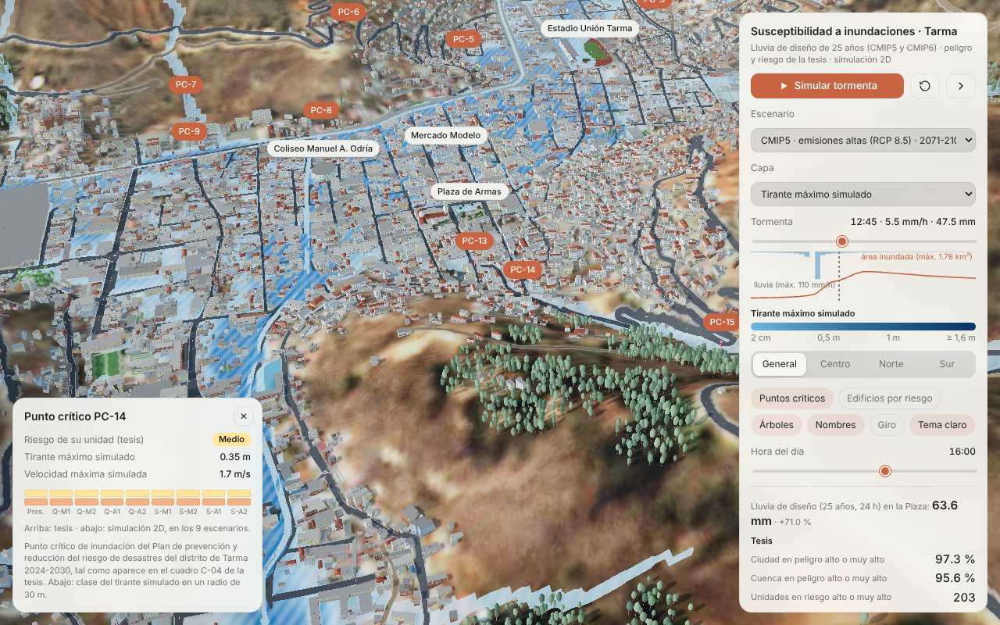
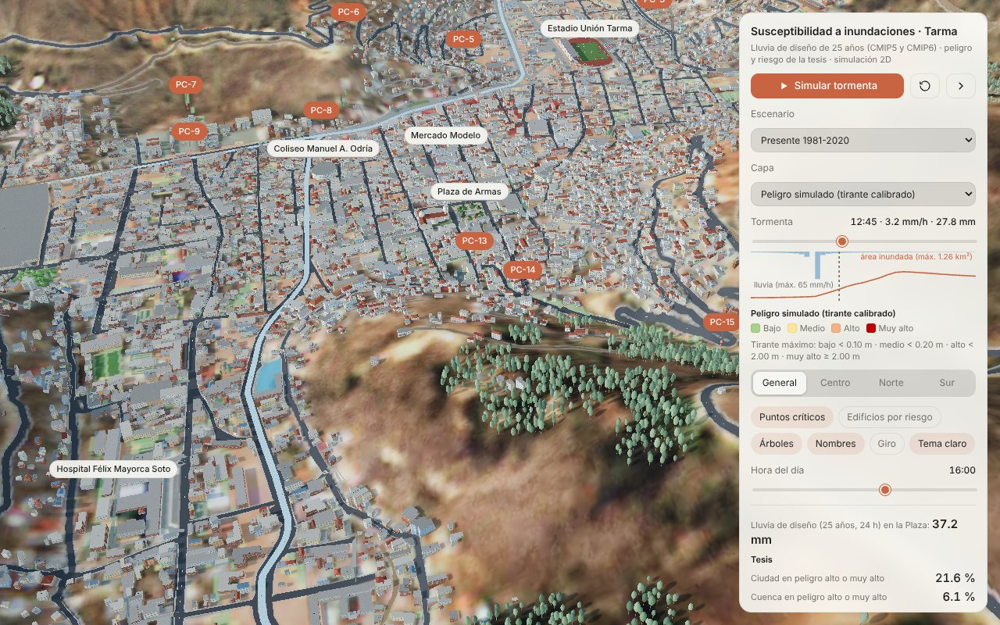

# Tarma 3D · Susceptibilidad a inundaciones

Modelo 3D interactivo de la ciudad de Tarma (Junín, Perú) con una **simulación 2D de inundación** para los 9 escenarios de lluvia de la tesis: el presente y CMIP5/CMIP6, con emisiones moderadas y altas, en 2031–2060 y 2071–2100. La simulación está calibrada con los mapas de peligro y riesgo de la tesis. Es el apoyo visual y numérico del artículo *Influencia espacio-temporal de las lluvias extremas proyectadas con CMIP5 y CMIP6 en el peligro hidrológico de la ciudad de Tarma* (Ramos Chagua y López Silva, UCSS).

Abre `Tarma_ciudad_3D.html` con doble clic en Chrome, Edge o Firefox. Necesita internet la primera vez, porque carga three.js desde jsDelivr. Funciona mejor en una computadora con tarjeta gráfica.



## Qué incluye

| | |
|---|---|
| **Mapas de la tesis** | **Riesgo (C-04).** 887 unidades (573 manzanas y 314 celdas de 1 ha) con su vulnerabilidad y su riesgo en los 9 escenarios. **Peligro (C-03).** Los 9 escenarios. **Puntos críticos.** Los 15 del cuadro C-04. Todo extraído de los PDF y georreferenciado al Plano Total 2025 |
| **Simulación 2D** | Tormenta de diseño de 25 años (24 h, bloques alternos con la IDF de la tesis) sobre una malla de 10 m (5,2 × 8 km). Usa el esquema inercial local, el terreno de las curvas del plano, las edificaciones como obstáculos, el cauce y los hidrogramas de 10 cuencas aportantes (SCS-CN e hidrograma unitario del SCS) |
| **Calibración** | Escenario presente, contra el riesgo por manzana de C-04: κ = 0,49, κ ponderado = 0,62 y 70,6 % de acuerdo. Es el mismo nivel que logra el propio mapa C-03 de la tesis pasado por la matriz de riesgo. Umbrales de peligro por tirante: 0,10, 0,20 y 2,0 m |
| **Animación de la tormenta** | El agua sube y baja en las calles de 10:00 a 17:00, con el hietograma y el área inundada en el gráfico |
| **Capas** | Inundación en el tiempo, tirante máximo, peligro de la tesis, riesgo de la tesis, peligro simulado, riesgo simulado y vulnerabilidad |
| **Fichas** | Por manzana: riesgo de la tesis y simulado en los 9 escenarios. Por punto crítico: tirante y velocidad. Por calle: tirante, velocidad, hora del máximo y ancho del plano |
| **Ciudad** | Terreno de las curvas del Plano Total 2025, 1 238 manzanas y calles del plano con veredas, edificios recortados a manzanas, y la Plaza de Armas, la Catedral y el Estadio como referencias |

| Riesgo por manzana · tesis (C-04), presente | Riesgo por manzana · simulación, presente | Peligro de la tesis (C-03), presente |
|---|---|---|
|  |  |  |
| **Riesgo · tesis, CMIP5 RCP 8.5 2071–2100** | **Riesgo · simulación, CMIP5 RCP 8.5 2071–2100** | **Tirante máximo, CMIP5 RCP 8.5 2071–2100** |
|  |  |  |
| **Ficha de manzana** | **Ficha de punto crítico** | **Peligro simulado (sur)** |
|  |  |  |

## Resultados por escenario

| Escenario | P24 en la Plaza | Unidades en riesgo alto: tesis · simulación | Área urbana con > 10 cm | Puntos críticos en peligro alto: tesis · simulación |
|---|---|---|---|---|
| Presente (1981–2020) | 37,2 mm | 63 · **59** | 1,40 km² | 9 · **7** |
| CMIP5 RCP 4.5 · 2031–2060 | 42,4 mm (+14 %) | 63 · **68** | 1,55 km² | 9 · **7** |
| CMIP5 RCP 4.5 · 2071–2100 | 42,6 mm (+14 %) | 63 · **70** | 1,58 km² | 9 · **7** |
| CMIP5 RCP 8.5 · 2031–2060 | 45,7 mm (+23 %) | 76 · **72** | 1,64 km² | 11 · **8** |
| CMIP5 RCP 8.5 · 2071–2100 | 63,6 mm (+71 %) | 203 · **94** | 2,02 km² | 15 · **9** |
| CMIP6 SSP2-4.5 · 2031–2060 | 41,4 mm (+11 %) | 63 · **63** | 1,50 km² | 9 · **7** |
| CMIP6 SSP2-4.5 · 2071–2100 | 50,2 mm (+35 %) | 77 · **78** | 1,72 km² | 11 · **9** |
| CMIP6 SSP5-8.5 · 2031–2060 | 41,5 mm (+12 %) | 63 · **64** | 1,52 km² | 9 · **7** |
| CMIP6 SSP5-8.5 · 2071–2100 | 50,7 mm (+36 %) | 78 · **81** | 1,76 km² | 11 · **9** |

«Unidades en riesgo alto» incluye las de riesgo alto y muy alto. Un punto crítico cuenta en la simulación si tiene al menos 0,20 m de agua a 30 m o menos.

- **Concordancia.** En 8 de los 9 escenarios, la simulación da casi el mismo número de unidades en riesgo alto que la tesis, con 6 unidades de diferencia o menos. Calibrada solo con el presente, reproduce también el aumento de los escenarios CMIP6 de 2071–2100: 78 frente a 79 en SSP2-4.5 y 81 frente a 80 en SSP5-8.5.
- **Excepción: CMIP5 RCP 8.5 2071–2100.** La tesis salta a 203 unidades y a 97 % de la ciudad en peligro alto. La simulación sube a 94 unidades y a 2,02 km² inundados (+45 %). El salto de la tesis es el de un factor de lluvia clasificado, que eleva de clase a toda la ciudad. La simulación concentra el aumento en el cauce, sus riberas y las calles bajas.
- **Profundidad.** El agua profunda (más de 50 cm) crece el doble de rápido que la extensión inundada: +19 % a +103 % frente a +7 % a +45 %.
- **Puntos críticos.** PC-2 a PC-6 y PC-15 no llegan a peligro alto en ningún escenario: tienen menos de 0,20 m. Es probable que dependan del drenaje o de obras que no están en el plano; son los primeros que conviene verificar en campo.

El método, la calibración, la discusión y las limitaciones están en `docs/metodologia_inundaciones.md`.

## Capas para SIG (QGIS, ArcGIS)

| Archivo | Contenido |
|---|---|
| `datos/inundacion/unidades_riesgo.geojson` | 887 unidades de C-04, con vulnerabilidad, riesgo de la tesis, riesgo simulado y tirante P90 por escenario |
| `datos/inundacion/puntos_criticos.geojson` | 15 puntos críticos, con tirante y velocidad máximos por escenario |
| `datos/inundacion/tirante_max_<código>.tif` | Tirante máximo simulado (m), 10 m, EPSG:32718 |
| `datos/inundacion/peligro_tesis_presente_cuenca.tif` | Peligro del presente (C-03) en toda la cuenca, EPSG:32718 |
| `datos/inundacion/resumen_escenarios.csv` | Tesis y simulación por escenario |
| `datos/inundacion/calibracion.csv` | Corridas de calibración |
| `datos/plano/` | Capas del Plano Total 2025: manzanas, vías, curvas de nivel y MDE de 5 m |

Los GeoJSON están en WGS84 (EPSG:4326). Los TIF están en UTM 18S, en el marco del Plano Total 2025. Los códigos de escenario son:

| Código | Escenario |
|---|---|
| `PRES` | Presente (1981–2020) |
| `QM1`, `QM2` | CMIP5 RCP 4.5 (2031–2060 y 2071–2100) |
| `QA1`, `QA2` | CMIP5 RCP 8.5 (2031–2060 y 2071–2100) |
| `SM1`, `SM2` | CMIP6 SSP2-4.5 (2031–2060 y 2071–2100) |
| `SA1`, `SA2` | CMIP6 SSP5-8.5 (2031–2060 y 2071–2100) |

## Estructura

```
Tarma_ciudad_3D.html                 modelo de susceptibilidad a inundaciones (un solo archivo)
datos/inundacion/                    capas SIG y tablas de la simulación y de la tesis
datos/plano/                         capas del Plano Total 2025 (base del modelo)
docs/metodologia_inundaciones.md     método, calibración, resultados y limitaciones (para la tesis y el artículo)
docs/capturas/                       imágenes del modelo
fuente/inundacion/                   código e insumos para repetir la simulación y regenerar el HTML
fuente/                              procesamiento de la ciudad base y de los planos del PDU
```

## Versión anterior (Jr. Chanchamayo)

El modelo detallado del Jr. Chanchamayo y del punto crítico T01 (lotes, fachadas, sección C3 y lámina de agua por el método racional) se retiró porque ya no forma parte de la investigación. Sigue en el historial de git: `git checkout ea45e99 -- Tarma_ciudad_3D.html datos docs herramientas`.
