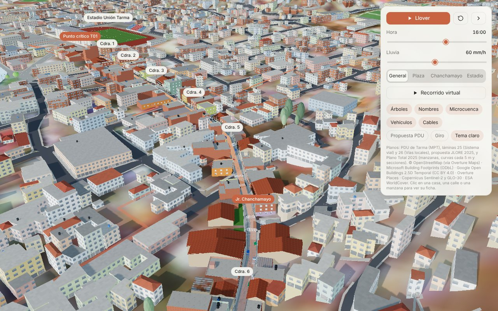
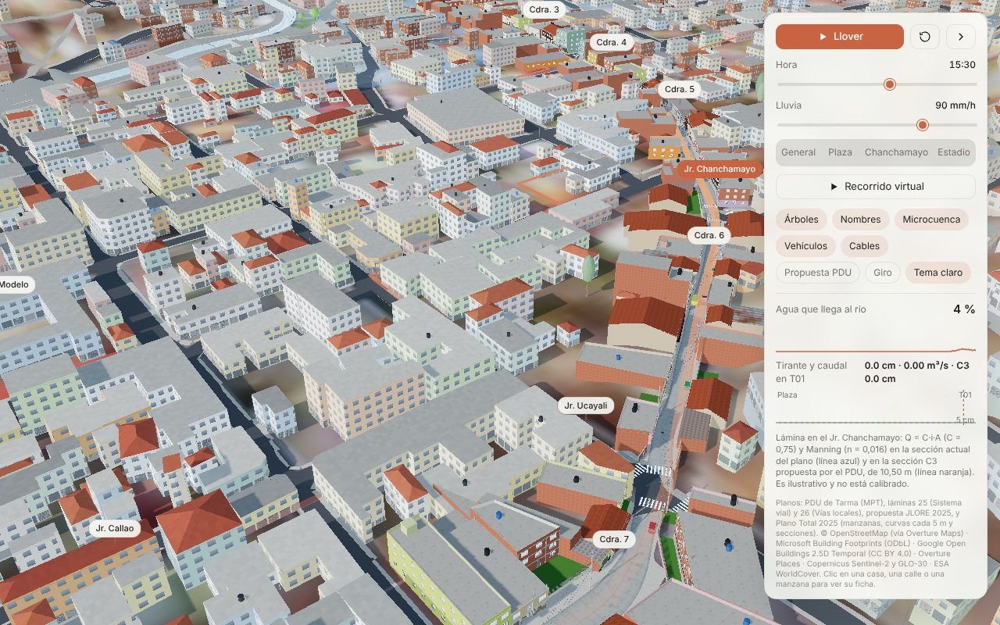
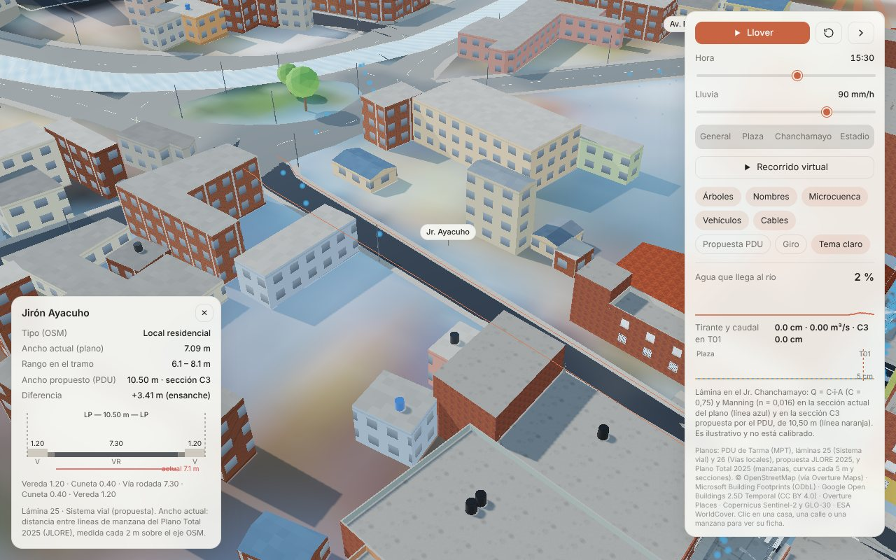
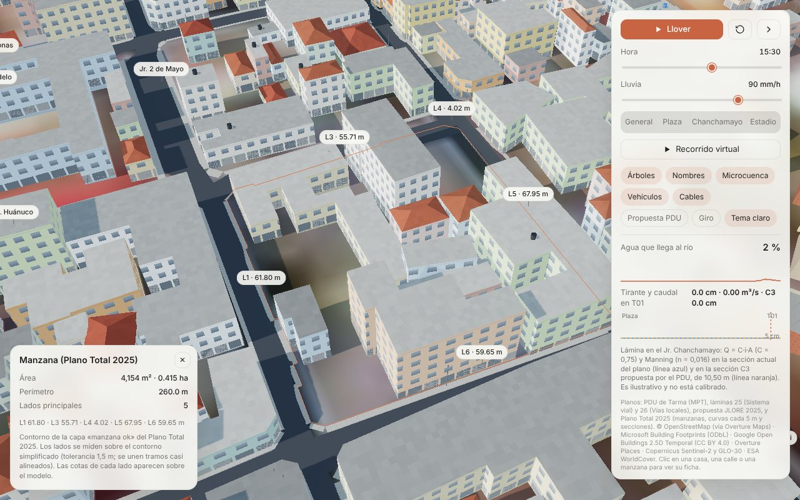
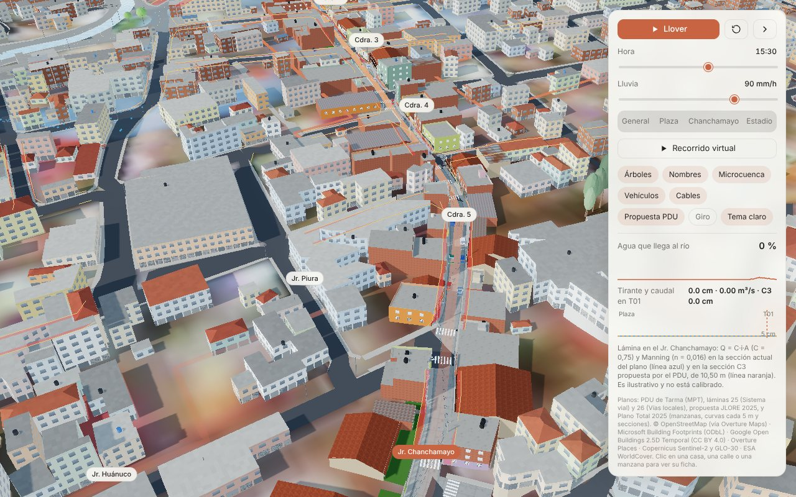
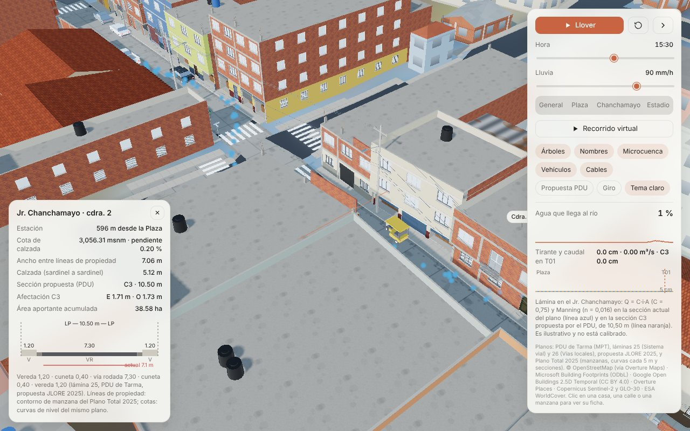
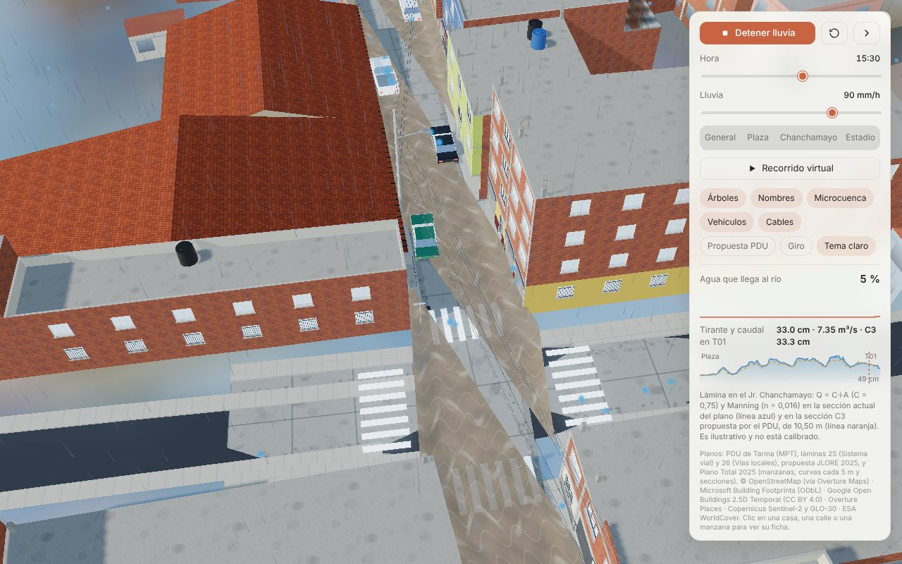
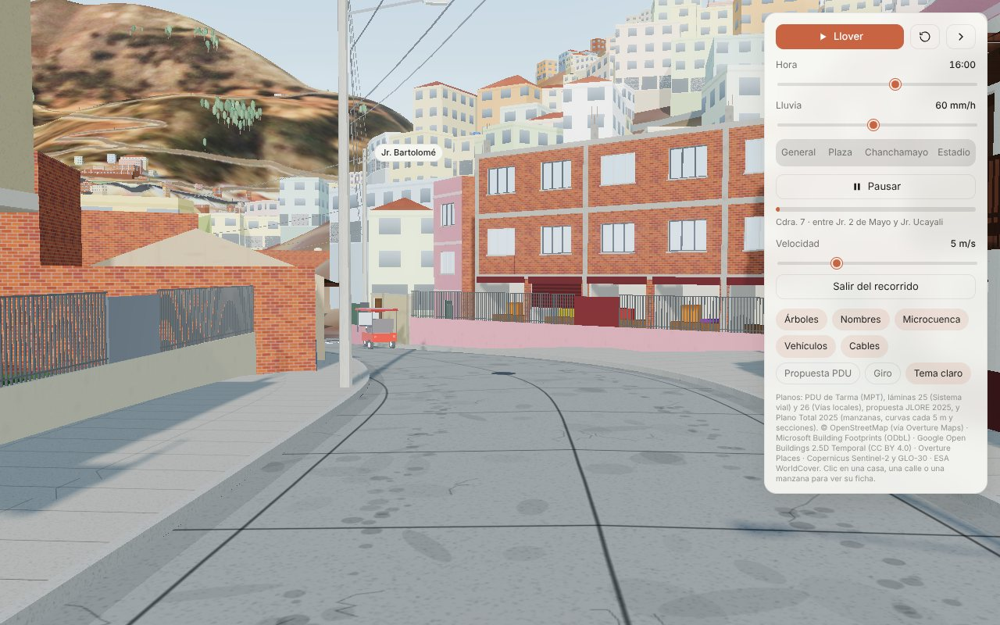
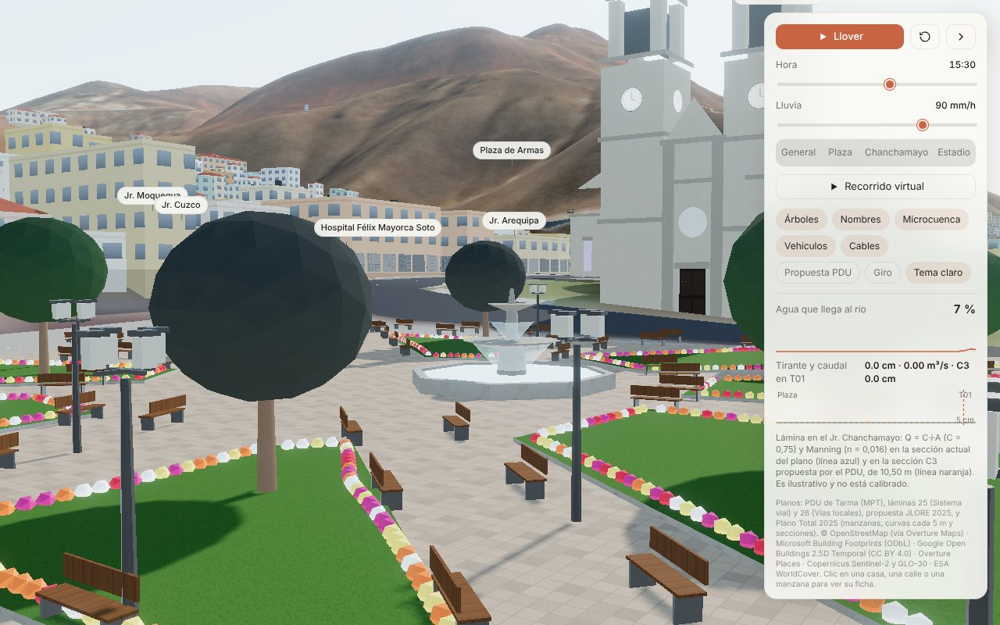
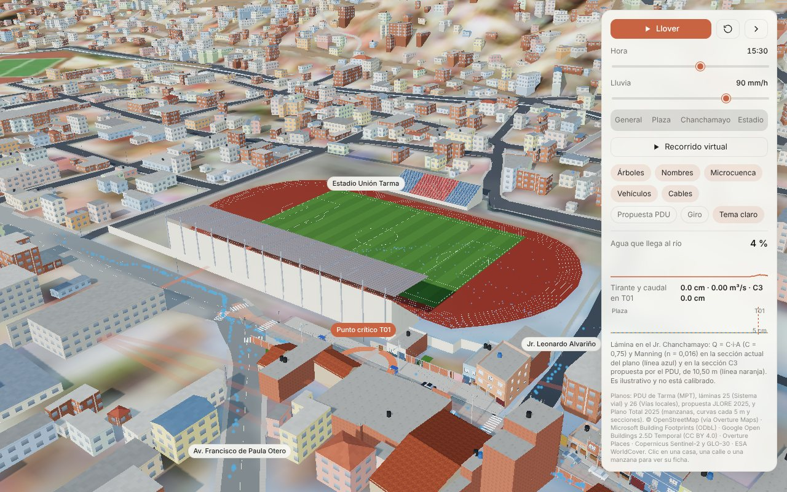

# Tarma 3D · Jr. Chanchamayo a detalle

Modelo 3D interactivo de la ciudad de Tarma (Junín, Perú) con el **Jr. Chanchamayo** modelado lote por lote, como apoyo a la tesis sobre escurrimiento urbano y la microcuenca del punto crítico T01.

Desde la versión de 2025, el modelo está **ajustado a los planos del PDU de Tarma**:

- láminas 25 (Sistema vial) y 26 (Vías locales) de la propuesta JLORE;
- Plano Total 2025 modificado.

Las cotas del terreno salen de las curvas de nivel del plano. Las manzanas, los anchos de calle y las líneas de propiedad salen del plano, y cada calle tiene la sección que le asigna la propuesta.

Abre `Tarma_ciudad_3D.html` con doble clic en Chrome, Edge o Firefox. Necesita internet la primera vez, porque carga three.js desde jsDelivr. Funciona mejor en una computadora con tarjeta gráfica.



## Qué incluye

| | |
|---|---|
| **Planos del PDU (2025)** | **Marco.** Todo el modelo está en el marco de coordenadas del Plano Total 2025 (WGS84 UTM 18S, como en el AutoCAD). **Terreno.** Sale de las curvas de nivel del plano, cada 5 m. **Calles.** 1 238 manzanas del plano; las calzadas tienen el ancho medido entre manzanas y hay veredas y sardineles en toda la ciudad. **Fichas.** Clic en una calle: ancho actual y ancho propuesto, con la sección típica dibujada (C1–C8, B1–B4, vías locales). Clic en una manzana: área, perímetro y cota de cada lado. **Propuesta PDU.** El botón marca en rojo la franja de los lotes que quedaría dentro de la vía ensanchada |
| **Jr. Chanchamayo (778,2 m, cuadras 1–7 y prolongación)** | 101 lotes con su volumen y altura reales (ráster Google Open Buildings 2.5D, 2023) y 26 cercos o terrenos sin edificar. Las líneas de propiedad y los linderos salen del contorno de manzana del plano, y el perfil longitudinal sale de sus curvas: de 3 065,4 a 3 053,9 m s. n. m., con 1,48 % de pendiente media. Las fachadas tienen vanos con derrame, rejas, persianas comerciales, balcones de concreto y de madera, volados, zócalos, pórticos de concreto visibles, techos de teja, losa o calamina, tanques Rotoplas y fierros en espera |
| **Sección propuesta C3** | La lámina 25 asigna al jirón la sección C3 de 10,50 m: vereda 1,20 · cuneta 0,40 · vía rodada 7,30 · cuneta 0,40 · vereda 1,20. Clic sobre la calzada: ficha de la estación con el ancho actual, la sección dibujada y la afectación por lado. La C3 afectaría a 86 de los 101 lotes, con una mediana de 1,27 m de frente |
| **Calle** | Calzada de losas de concreto con bombeo del 2 %, cunetas, sardineles de 17 cm, veredas con bruñas, empalmes de 12 calles transversales, cruceros peatonales, 26 buzones y 44 sumideros |
| **Mobiliario** | 24 postes de concreto con cruceta, alumbrado, transformadores y cables. 3 semáforos (los cruces semaforizados según OSM), placas con el nombre de las calles y 38 vehículos estacionados: autos, mototaxis, combis y camionetas |
| **Negocios reales** | 12 letreros con nombre y dirección en el jirón (Overture Places / Meta y fuentes web), en ubicación aproximada |
| **Recorrido virtual** | Recorrido a nivel de calle desde la Plaza de Armas hasta la Av. Manuel Odría, con pausa para mirar alrededor, control de velocidad y el tramo actual en pantalla |
| **Ficha de lote** | Clic en una casa: cuadra, lado, N° aproximado, pisos, altura, frente y fondo, línea de propiedad, afectación C3, uso y tipología |
| **Lluvia y lámina de agua** | Q = C·i·A (método racional) y Manning en la sección actual del plano (línea azul) y en la sección C3 propuesta (línea naranja). Muestra el tirante y el caudal en T01 y el perfil del tirante a lo largo del jirón. **Es ilustrativo y no está calibrado** |
| **Hitos remasterizados** | Plaza de Armas (jardines, flores, pileta de dos tazas, bancas, faroles), Catedral Santa Ana (neoclásica, cruz latina, cúpula, dos torres con reloj y campanario) y Estadio Unión Tarma (cancha reglamentaria, pista atlética, tribuna occidente techada, tribuna oriente) |

La ciudad base, la microcuenca, el eje y la simulación de lluvia del modelo original se conservan. Se trasladaron al marco del plano.

| Calles del plano | Ficha de vía (sección C3) | Ficha de manzana |
|---|---|---|
|  |  |  |
| **Propuesta PDU (ensanches)** | **Jr. Chanchamayo, cuadra 2: actual vs. C3** | **Lámina de agua (90 mm/h)** |
|  |  |  |
| **Calle (cdra. 7)** | **Plaza de Armas** | **Estadio** |
|  |  |  |

## Lo que dicen los planos (resumen para la tesis)

- **Desfase horizontal.** Las capas satelitales (OSM, Microsoft, Google, Sentinel-2) estaban desplazadas respecto al plano: en mediana 1,25 m al oeste y 5,5 m al norte. El desfase varía en la ciudad y se corrigió con un campo suave.
- **Cotas.** Las curvas del plano están unos **10,2 m más arriba** que el MDE Copernicus GLO-30. En la Plaza de Armas, el plano da 3 066,2 m y el GLO-30, 3 056,7 m. Probablemente es un datum vertical distinto. Conviene confirmarlo con un BM del IGN; para la hidráulica cuentan las pendientes, que no cambian.
- **Jr. Chanchamayo.** Mide hoy 8,43 m entre líneas de propiedad (mediana). El 75 % del tramo es más angosto que los 10,50 m de la sección C3 propuesta.
- **Lluvia de 60 mm/h.** En la cuadra 2 (7,0 m de ancho, pendiente mínima), el tirante máximo bajaría de 40,1 a 33,3 cm con la C3. En T01 casi no cambia (28,7 → 27,7 cm), porque ahí la calle ya es más ancha.
- **Detalle.** El método completo, las tablas de secciones y las limitaciones están en `docs/metodologia_jr_chanchamayo.md`, sección 7.

## Corregir el modelo con tu levantamiento de campo

1. Abre `datos/lotes_jr_chanchamayo.csv` en Excel o LibreOffice. Hay una fila por lote, con coordenadas de la fachada en WGS84 y UTM 18S (marco del plano).
2. Corrige lo que observes en campo: `pisos`, `altura_m`, `tipologia` (`adobe` / `ladrillo` / `tarrajeo`), `uso` (`comercio` / `vivienda`), `techo` (`teja` / `losa` / `calamina`), `color_fachada` (hex, p. ej. `#E8C25A`), `volado`, `balcon`, `obra_inconclusa`, `tanque` (1/0) y `nombre_negocio`. Marca la columna `verificado_en_campo`.
3. Ejecuta `python herramientas/actualizar_lotes.py`. Solo necesita Python 3 y reescribe el HTML; deja una copia `.bak`.

## Capas para SIG (QGIS, ArcGIS) y AutoCAD

| Archivo | Contenido |
|---|---|
| `datos/lotes_jr_chanchamayo.csv` / `.geojson` | Lotes del jirón, con línea de propiedad y afectación C3 |
| `datos/eje_jr_chanchamayo.geojson` | Eje del jirón centrado entre las líneas del plano |
| `datos/plano/manzanas_plano.geojson` | Manzanas del Plano Total 2025, con área, perímetro y lados |
| `datos/plano/vias_plano.geojson` | Calles con ancho actual, ancho propuesto y sección del PDU |
| `datos/plano/cotas_vias_locales.geojson` | Cotas de la lámina 26: ancho dibujado y ancho propuesto |
| `datos/plano/secciones_viales.csv` | Secciones típicas (láminas 25 y 26) con sus componentes |
| `datos/plano/perfil_jr_chanchamayo.csv` | Perfil del jirón cada 2 m: cotas, anchos, afectación y área aportante |
| `datos/plano/mde_plano_5m.tif` | MDE de 5 m con las curvas del plano (EPSG:32718) |
| `datos/plano/curvas_nivel_plano.zip` | Curvas de nivel del plano (shapefile, EPSG:32718) |

Los GeoJSON están en WGS84 (EPSG:4326). El TIF y el shapefile están en UTM 18S, en el mismo marco que el AutoCAD.

## Estructura

```
Tarma_ciudad_3D.html           modelo final (un solo archivo)
datos/                         tabla de lotes editable (CSV) y capas SIG (GeoJSON, TIF, SHP)
herramientas/                  actualizar_lotes.py
docs/metodologia_jr_chanchamayo.md   método, fuentes, supuestos y limitaciones (para la tesis)
docs/capturas/                 imágenes del modelo
fuente/                        código y datos para regenerar el HTML (ver fuente/README.md)
```

## Fuentes y licencias

- **Planos.** PDU de Tarma de la Municipalidad Provincial de Tarma: láminas 25 (Sistema vial) y 26 (Vías locales), propuesta JLORE 2025, y Plano Total 2025 modificado por JLORE. Se usaron las manzanas, las curvas de nivel, las secciones viales, los nombres de calles y los linderos de equipamientos. No se incluyen los DWG ni los nombres de propietarios. Antes de publicar las capas derivadas de `datos/plano/`, conviene confirmar con los autores de los planos que se pueden difundir.
- © Colaboradores de OpenStreetMap (ODbL), vía Overture Maps Foundation (release 2026-09-23.1): ejes de vías, cruces, semáforos, uso de suelo, ríos, plaza, catedral y estadio.
- Google Open Buildings 2.5D Temporal v1, 2023 (CC BY 4.0): presencia y altura de edificaciones a 0,5 m.
- Microsoft y Google building footprints vía Overture (ODbL / CC BY 4.0): pistas de linderos y ciudad base.
- Overture Places (CDLA-Permissive-2.0): negocios con dirección en el jirón.
- Copernicus GLO-30, Sentinel-2 y ESA WorldCover: terreno fuera del casco urbano y textura del modelo original.

**Límites que conviene declarar en la tesis:**

- **Street View e imágenes satelitales.** Desde el entorno donde se hizo este trabajo no hubo acceso a Google Street View ni a imágenes satelitales de alta resolución, porque la red estaba restringida. Además, los términos de Google Maps Platform prohíben crear modelos 3D a partir de Street View.
- **Datos medidos.** Las líneas de propiedad, los anchos de calle y las cotas salen de los planos. El volumen y la altura de los edificios salen de datos abiertos medidos.
- **Datos representativos.** Los colores, materiales, vanos y usos son **representativos**: se asignaron por reglas y deben verificarse en campo con la tabla CSV. Las veredas de la ciudad, fuera del jirón, también son representativas.

Los detalles están en `docs/metodologia_jr_chanchamayo.md`.
