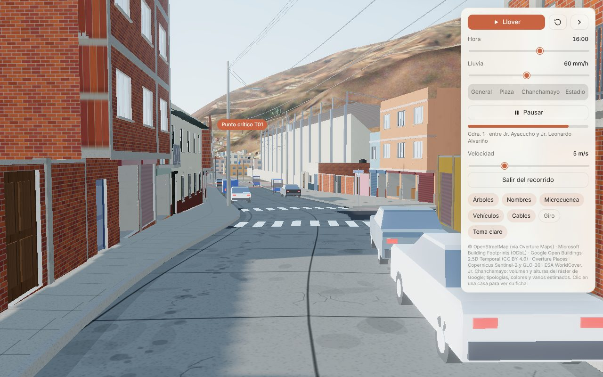
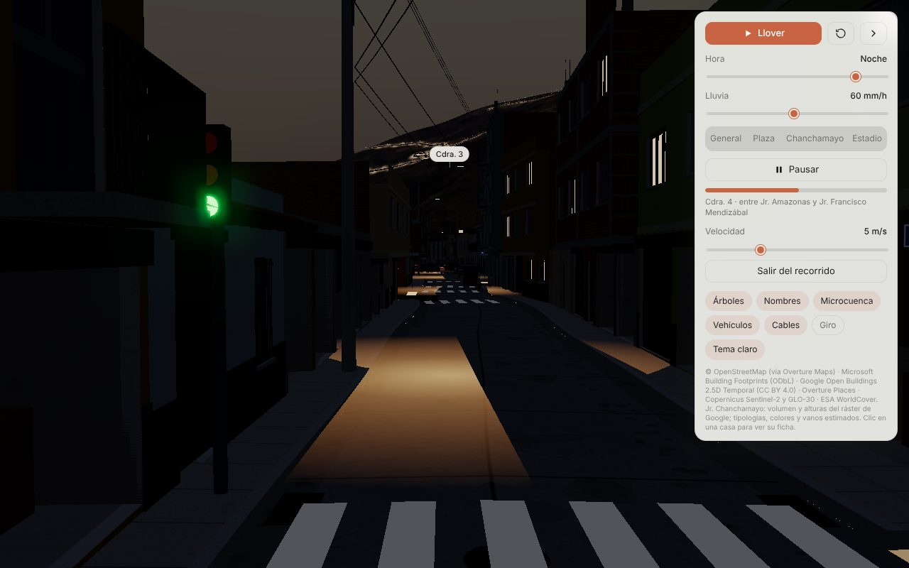

# Tarma 3D · Jr. Chanchamayo a detalle

Modelo 3D interactivo de la ciudad de Tarma (Junín, Perú) con el **Jr. Chanchamayo** modelado lote por lote, como apoyo a la tesis sobre escurrimiento urbano y la microcuenca del punto crítico T01.

Abre `Tarma_ciudad_3D.html` con doble clic en Chrome, Edge o Firefox. Necesita internet la primera vez, porque carga three.js desde jsDelivr. Funciona mejor en una computadora con tarjeta gráfica.


## Qué incluye

| | |
|---|---|
| **Jr. Chanchamayo (779,5 m, cuadras 1–7 y prolongación)** | 101 lotes con su volumen y altura reales (ráster Google Open Buildings 2.5D, 2023) y 26 cercos o terrenos sin edificar. Las fachadas tienen vanos con derrame, rejas, persianas comerciales, balcones de concreto y de madera, volados, zócalos, pórticos de concreto visibles, techos de teja, losa o calamina, tanques Rotoplas y fierros en espera |
| **Calle** | Eje recentrado con el ráster. Calzada de losas de concreto con bombeo del 2 %, cunetas, sardineles de 17 cm, veredas con bruñas, empalmes de 12 calles transversales, cruceros peatonales, 26 buzones y 44 sumideros |
| **Mobiliario** | 24 postes de concreto con cruceta, alumbrado, transformadores y cables. 3 semáforos (los cruces semaforizados según OSM), placas con el nombre de las calles y 38 vehículos estacionados: autos, mototaxis, combis y camionetas |
| **Negocios reales** | 12 letreros con nombre y dirección en el jirón (Overture Places / Meta y fuentes web), en ubicación aproximada |
| **Recorrido virtual** | Recorrido a nivel de calle desde la Plaza de Armas hasta la Av. Manuel Odría, con pausa para mirar alrededor, control de velocidad y el tramo actual en pantalla |
| **Ficha de lote** | Clic en una casa: cuadra, lado, N° aproximado, pisos, altura, frente y fondo, uso y tipología |
| **Lluvia y lámina de agua** | Q = C·i·A (método racional) y Manning en la sección transversal real de la calle. Muestra el tirante y el caudal en T01 y el perfil del tirante a lo largo del jirón. **Es ilustrativo y no está calibrado** |
| **Hitos remasterizados** | Plaza de Armas (jardines, flores, pileta de dos tazas, bancas, faroles), Catedral Santa Ana (neoclásica, cruz latina, cúpula, dos torres con reloj y campanario) y Estadio Unión Tarma (cancha reglamentaria, pista atlética, tribuna occidente techada, tribuna oriente) |

El resto de la ciudad, el terreno, la microcuenca, el eje y la simulación de lluvia original se conservan.

| Calle (cdra. 7) | Calle (cdra. 1, estadio) | Noche |
|---|---|---|
|  |  |  |
| **Lámina de agua (90 mm/h)** | **Plaza de Armas** | **Estadio** |
|  |  |  |

## Corregir el modelo con tu levantamiento de campo

1. Abre `datos/lotes_jr_chanchamayo.csv` en Excel o LibreOffice. Hay una fila por lote, con coordenadas de la fachada en WGS84 y UTM 18S.
2. Corrige lo que observes en campo: `pisos`, `altura_m`, `tipologia` (`adobe` / `ladrillo` / `tarrajeo`), `uso` (`comercio` / `vivienda`), `techo` (`teja` / `losa` / `calamina`), `color_fachada` (hex, p. ej. `#E8C25A`), `volado`, `balcon`, `obra_inconclusa`, `tanque` (1/0) y `nombre_negocio`. Marca la columna `verificado_en_campo`.
3. Ejecuta `python herramientas/actualizar_lotes.py`. Solo necesita Python 3 y reescribe el HTML; deja una copia `.bak`.

También están `datos/lotes_jr_chanchamayo.geojson` y `datos/eje_jr_chanchamayo.geojson` para QGIS o ArcGIS.

## Estructura

```
Tarma_ciudad_3D.html           modelo final (un solo archivo, ~4,7 MB)
datos/                         tabla de lotes editable (CSV) y capas SIG (GeoJSON)
herramientas/                  actualizar_lotes.py
docs/metodologia_jr_chanchamayo.md   método, fuentes, supuestos y limitaciones (para la tesis)
docs/capturas/                 imágenes del modelo
fuente/                        código y datos para regenerar el HTML (ver fuente/README.md)
```

## Fuentes y licencias

- © Colaboradores de OpenStreetMap (ODbL), vía Overture Maps Foundation (release 2026-09-23.1): vías, cruces, semáforos, uso de suelo, ríos, plaza, catedral y estadio.
- Google Open Buildings 2.5D Temporal v1, 2023 (CC BY 4.0): presencia y altura de edificaciones a 0,5 m.
- Microsoft y Google building footprints vía Overture (ODbL / CC BY 4.0): pistas de linderos y ciudad base.
- Overture Places (CDLA-Permissive-2.0): negocios con dirección en el jirón.
- Copernicus GLO-30, Sentinel-2 y ESA WorldCover: terreno y textura del modelo original.

**Límites que conviene declarar en la tesis.** Desde el entorno donde se hizo este trabajo no hubo acceso a Google Street View ni a imágenes satelitales de alta resolución: la red estaba restringida. Además, los términos de Google Maps Platform prohíben crear modelos 3D a partir de Street View. Por eso el volumen, la altura, el ancho de calle y la pendiente salen de datos abiertos medidos. Los colores, materiales, vanos y usos son **representativos**: se asignaron por reglas y deben verificarse en campo con la tabla CSV. Los detalles están en `docs/metodologia_jr_chanchamayo.md`.
